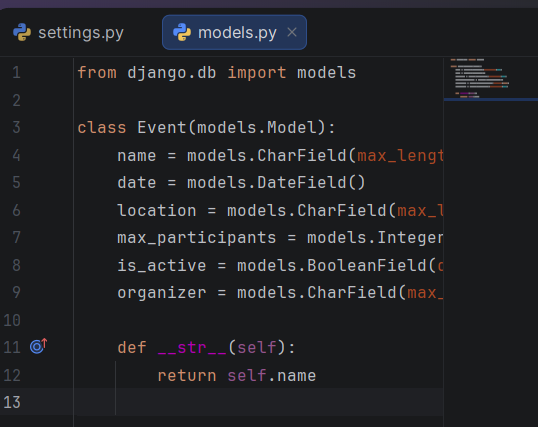
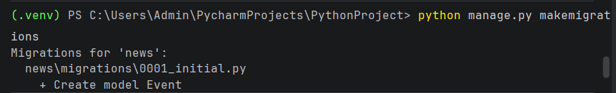
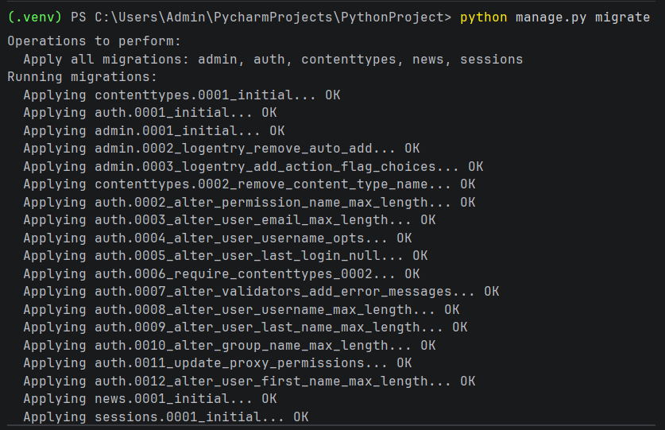
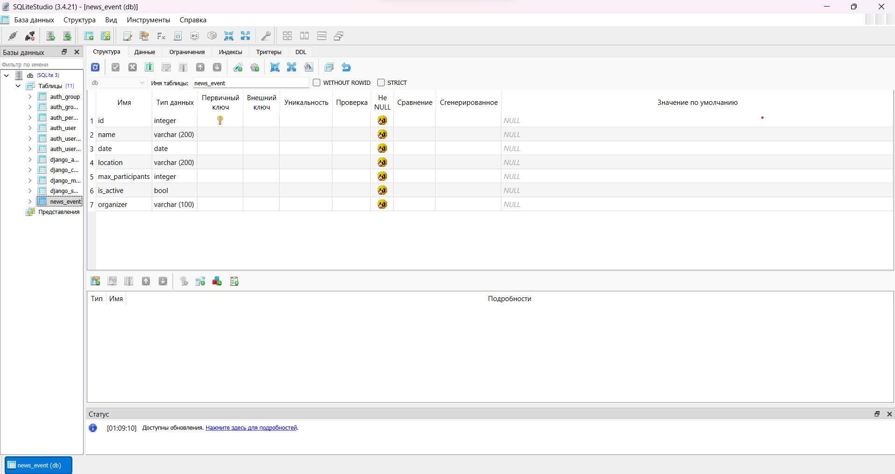
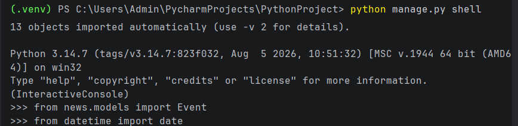
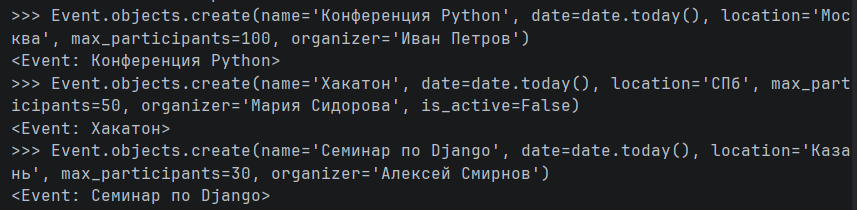
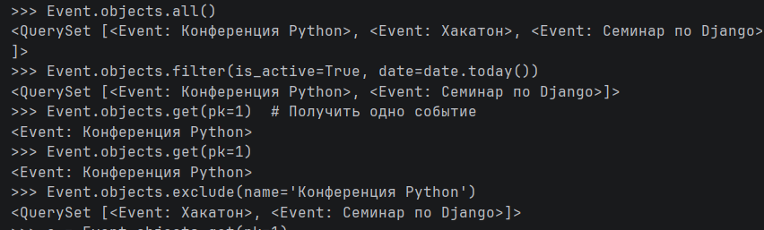
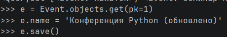
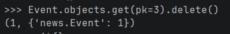
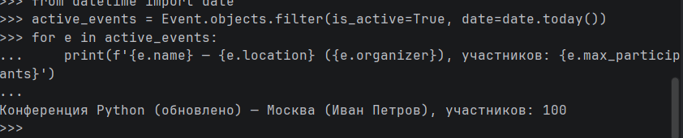

МИНИСТЕРСТВО НАУКИ И ВЫСШЕГО ОБРАЗОВАНИЯ РОССИЙСКОЙ ФЕДЕРАЦИИ
Федеральное государственное автономное образовательное учреждение высшего образования
«СЕВЕРО-КАВКАЗСКИЙ ФЕДЕРАЛЬНЫЙ УНИВЕРСИТЕТ»
Институт перспективной инженерии
Департамент цифровых робототехнических систем и электроники
Межинститутская базовая кафедра

# Отчет к лабораторной работе № 2

**Тема:** Модели. CRUD.
**Дисциплина:** Разработка web-приложений

## Выполнила:

Студент группы ПИЖ-б-о-25-1 (2),
направление подготовки: 09.03.04 «Программная инженерия»
Осипенко Юлия Юрьевна

## Проверила:

ассистент межинститутской базовой кафедры департамента цифровых, робототехнических систем и электроники института перспективной инженерии

Белик Ангелина Игоревна

Ставрополь 2026

---

**Цель работы:** разработка моделей, научиться проводить миграцию данных, работа с базой данных.

## Ход выполнения лабораторной работы

**Вариант 5. События (Event)**

- Создать модель `Event` (поля: `name`, `date`, `location`, `max_participants`, `is_active`). 
- Добавить поле `organizer` (строка, максимум 100 символов),
- Вывести все активные события на текущую дату.


### 1. Создание модели Event

В файле `news/models.py` создана модель `Event`.

```python
class Event(models.Model):
    name = models.CharField(max_length=200)
    date = models.DateField()
    location = models.CharField(max_length=200)
    max_participants = models.IntegerField()
    is_active = models.BooleanField(default=True)
    organizer = models.CharField(max_length=100)

    def __str__(self):
        return self.name
```



*(Рисунок 1 – модель Event)*

| Поле | Тип | Назначение |
| :--- | :--- | :--- |
| `name` | `CharField(200)` | Название события |
| `date` | `DateField` | Дата проведения |
| `location` | `CharField(200)` | Место проведения |
| `max_participants` | `IntegerField` | Максимальное количество участников |
| `is_active` | `BooleanField(default=True)` | Активно ли событие |
| `organizer` | `CharField(100)` | Организатор события |

*(Таблица 1 – Описание полей)*

Метод `__str__` возвращает название события.

### 2. Миграции

Создана миграция:

```bash
python manage.py makemigrations
```



*(Рисунок 2 – python manage.py makemigrations)*

Применена миграция:

```bash
python manage.py migrate
```



*(Рисунок 3 – Результат применения миграции)*

В базе данных появилась таблица `news_event`:



*(Рисунок 4 – Таблица news_event)*

### 3. Работа с ORM (консоль Django)

Запуск консоли:

```bash
python manage.py shell
```

Импорт модели и библиотеки для работы с датами:

```python
from news.models import Event
from datetime import date
```



*(Рисунок 5 – Работа с ORM)*

### 4. Создание записей

Создано 3 записи (одна из них неактивная, чтобы показать работу фильтра):

```python
Event.objects.create(name='Конференция Python', date=date.today(), location='Москва', max_participants=100, organizer='Иван Петров')
Event.objects.create(name='Хакатон', date=date.today(), location='Санкт-Петербург', max_participants=50, organizer='Мария Сидорова', is_active=False)
Event.objects.create(name='Семинар по Django', date=date.today(), location='Казань', max_participants=30, organizer='Алексей Смирнов')
```



*(Рисунок 6 – Создание записей)*

### 5. Чтение данных

Все записи:

```python
Event.objects.all()
```

**Выполнение индивидуального задания (Вывод всех активных событий на текущую дату):**

```python
Event.objects.filter(is_active=True, date=date.today())
```

Одна запись по id:

```python
Event.objects.get(pk=1)
```

Исключение:

```python
Event.objects.exclude(name='Конференция Python')
```



*(Рисунок 7 – Чтение данных)*

### 6. Обновление

Изменить одну запись (переименовать событие):

```python
e = Event.objects.get(pk=1)
e.name = 'Конференция Python (обновлено)'
e.save()
```

Проверить:

```python
Event.objects.get(pk=1)
```



*(Рисунок 8 – Обновление записи)*

### 7. Удаление

Удалить одну запись с `pk=3`:

```python
Event.objects.get(pk=3).delete()
```

Проверка:

```python
Event.objects.all()
```



*(Рисунок 9 – Удаление)*

### 8. Результаты работы

Вывод всех активных событий на текущую дату с подробной информацией:

```python
active_events = Event.objects.filter(is_active=True, date=date.today())
for e in active_events:
    print(f'{e.name} — {e.location} ({e.organizer}), участников: {e.max_participants}')
```



*(Рисунок 10 – Результаты)*

**Ссылка на гитхаб:** https://github.com/vmsteg/web

## Контрольные вопросы

**1. Что такое модель в Django и для чего она используется?**
Модель – это класс Python, наследник `django.db.models.Model`, описывающий структуру таблицы БД. Используется для хранения и извлечения данных через ORM без написания SQL.

**2. Какие типы полей вы знаете?**
`CharField`, `TextField`, `IntegerField`, `DateTimeField`, `DateField`, `BooleanField`, `EmailField`, `ImageField`, `ForeignKey` и др.

**3. Чем отличаются `blank=True` и `null=True`?**
`blank=True` – поле может быть пустым в формах. `null=True` – в БД может храниться `NULL`.

**4. Что такое миграции и зачем они нужны?**
Миграции – способ применения изменений моделей к схеме БД. Команды:
- `python manage.py makemigrations` – создать миграции.
- `python manage.py migrate` – применить.
- `python manage.py sqlmigrate <app> <name>` – показать SQL.

**5. Как создать суперпользователя?**
```bash
python manage.py createsuperuser
```

**6. Что такое ORM? Основные методы CRUD?**
ORM – Object-Relational Mapping, работа с БД через Python-объекты.
- Create: `Model.objects.create(...)`, `obj.save()`
- Read: `all()`, `filter()`, `get()`, `exclude()`
- Update: `obj.save()`, `QuerySet.update()`
- Delete: `obj.delete()`

**7. В чём разница между `filter()` и `get()`?**
`filter()` возвращает `QuerySet` (может быть пустым или содержать много записей). `get()` возвращает один объект, выбрасывает исключение при отсутствии или множестве записей.

**8. Как настроить загрузку изображений?**
В `settings.py`: `MEDIA_ROOT`, `MEDIA_URL`. В `urls.py`: `static(settings.MEDIA_URL, document_root=settings.MEDIA_ROOT)` при `DEBUG=True`. В модели: `ImageField(upload_to='...')`.

**9. Для чего нужен `__str__`?**
Для читаемого строкового представления объекта (в админке, консоли, шаблонах).

**10. Что произойдёт, если выполнить `makemigrations`, но не `migrate`?**
Файл миграции будет создан, но изменения не применятся к БД. Таблица не появится.

## Вывод

В ходе выполнения лабораторной работы были разработаны модели, освоены процессы миграции данных и методы работы с базой данных через ORM (CRUD-операции), а также выполнено индивидуальное задание по фильтрации данных.
